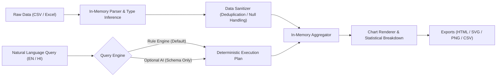

# 📊 Natural Language Data Analyst

<div align="center">

[](https://www.python.org/)
[](LICENSE)
[](#-privacy--security-model)
[](server.py)
[](#-bilingual-support-english--hindi)
[](CONTRIBUTING.md)

**A private, local-first conversational data analysis workbench.**  
Upload CSV or Excel spreadsheets, inspect and cleanse records, and query datasets in plain English or Hindi — receiving interactive charts, statistical methodology breakdowns, and standalone audit reports with zero cloud telemetry.

[Features](#-key-features) • [Quickstart](#-quickstart) • [How It Works](#-how-it-works) • [Privacy Model](#-privacy--security-model) • [Documentation](#-project-structure)

</div>

---

## 🌟 Key Features

- 🔒 **100% Local-First & Privacy-Preserving**  
  Your raw data never leaves your computer. All parsing, aggregation, statistics, and visualization rendering execute in-memory on `localhost`.
- 💬 **Conversational Natural Language Queries**  
  Ask direct analytical questions like *"What is the average revenue by region?"* or *"Show monthly sales trends for 2024"*.
- 🇮🇳 **Bilingual Support (English & Hindi)**  
  Full UI toggle and natural language question answering in both English and Hindi (*"क्षेत्र के अनुसार कुल बिक्री क्या है?"*).
- 🧹 **Automated Data Inspection & Cleaning**  
  Instant type inference, duplicate record detection, blank count auditing, and one-click data sanitation with full **Undo** capability.
- 📈 **Dynamic Visualizations & Method Transparency**  
  Generates responsive bar, line, and comparison charts, accompanied by source row counts and explicit algorithmic calculation steps.
- 📑 **Comprehensive Export Suite**  
  Export results as vector SVG charts, high-resolution PNGs, filtered CSV datasets, or self-contained interactive HTML audit reports.
- ⚡ **Zero-Dependency Core**  
  Runs on Python's standard library alone for CSV files. Requires only `openpyxl` for Excel (`.xlsx`/`.xlsm`) parsing.
- 🤖 **Optional AI Wording Copilot**  
  Plug in OpenAI (`gpt-4o-mini`) for nuanced phrasing interpretation. Even when enabled, **only the question and column schema are sent**—never your raw data rows!

---

## 🏗️ Architecture & Query Pipeline



---

## 🚀 Quickstart

### Prerequisites

- **Python 3.10+** installed on your system.

### 1. Clone the Repository

```bash
git clone https://github.com/suyashsrivastava803/natural-language-data-analyst.git
cd natural-language-data-analyst
```

### 2. (Optional) Enable Excel (`.xlsx` / `.xlsm`) Support

CSV analysis requires zero third-party dependencies. To enable Microsoft Excel workbook analysis:

```bash
python -m pip install -r requirements.txt
```

### 3. Launch the Application

#### On Windows:
Double-click `run.bat` or run:
```powershell
python server.py
```

#### On macOS / Linux:
```bash
python3 server.py
```

The application will launch automatically in your default browser at:
```
http://127.0.0.1:8001
```
*(If port `8001` is busy, the server automatically finds and binds to the next available port).*

---

## 💡 Example Queries

You can ask straightforward or complex aggregate questions across any loaded dataset:

| Category | Example Query (English) | Example Query (Hindi) |
|---|---|---|
| **Aggregations** | *"What is the total sales amount?"* | *"कुल बिक्री कितनी है?"* |
| **Averages & Medians** | *"Show average customer age"* | *"ग्राहकों की औसत आयु क्या है?"* |
| **Grouping & Categorical** | *"Compare revenue across product categories"* | *"श्रेणी के अनुसार राजस्व की तुलना करें"* |
| **Time Series & Trends** | *"Monthly order volume trend"* | *"महीने के अनुसार ऑर्डर का रुझान"* |
| **Correlations & Ranges** | *"Correlation between discount and profit"* | *"छूट और लाभ के बीच संबंध क्या है?"* |

---

## 🤖 Optional AI Enhancement

By default, Fieldnote uses a built-in deterministic query interpreter that requires **no API keys, no internet connection, and zero cost**.

If you wish to enable flexible phrasing through an LLM:

1. Copy the environment configuration:
   ```bash
   cp .env.example .env
   ```
2. Open `.env` and add your OpenAI API key:
   ```env
   OPENAI_API_KEY=sk-...
   OPENAI_MODEL=gpt-4o-mini
   ```
3. Restart the server and toggle **AI wording help** in the UI.

> [!NOTE]  
> **Privacy Guarantee**: Fieldnote only sends the user's question and sanitized column headers/types to the LLM. Data rows **never** leave your local machine.

---

## 🔒 Privacy & Security Model

- **Localhost Binding**: Server binds exclusively to `127.0.0.1`.
- **Ephemeral Dataset Storage**: Uploaded files and datasets are processed strictly in-memory during server runtime and purged upon process exit.
- **Secure Local Authentication**: Credentials are stored locally in an embedded SQLite database (`fieldnote.sqlite3`) using salted PBKDF2-HMAC-SHA256 password hashing.
- **Deterministic Sandboxing**: No arbitrary Python code generation or unvetted SQL evaluation is executed against datasets.
- For internet-facing deployment considerations, please consult [DEPLOYMENT.md](DEPLOYMENT.md).

---

## 📂 Project Structure

```text
natural-language-data-analyst/
├── .github/
│   ├── workflows/
│   │   └── ci.yml               # Automated CI test workflow
│   └── ISSUE_TEMPLATE/          # Issue & feature request templates
├── .env.example                 # Environment configuration template
├── .gitignore                   # Comprehensive git exclusions
├── app.js                       # Frontend reactive UI logic & Chart rendering
├── CONTRIBUTING.md              # Contributor guidelines
├── DEPLOYMENT.md                # Security & production hosting checklist
├── index.html                   # Semantic, accessible web interface
├── LICENSE                      # MIT Open Source License
├── README.md                    # Project documentation & manual
├── requirements.txt             # Optional openpyxl dependency
├── run.bat                      # One-click Windows runner
├── server.py                    # Core HTTP server, parser, local query engine
├── styles.css                   # Responsive typography & clean theme styles
└── SECURITY.md                  # Security and disclosure policy
```

---

## 🛠️ Tech Stack

- **Backend**: Python 3.10+ (Built primarily on standard library: `http.server`, `sqlite3`, `csv`, `statistics`, `hashlib`)
- **Frontend**: Vanilla JavaScript (ES6+), HTML5, CSS3 with responsive CSS variables & Dark/Light mode
- **Visualization**: Dynamic SVG vector rendering and canvas export
- **Database**: SQLite3 (for local user sessions and auth tokens)

---

## 🤝 Contributing

Contributions, feedback, and star ratings are welcome! Check out [CONTRIBUTING.md](CONTRIBUTING.md) to get started.

---

## 📄 License

This project is open-source and available under the [MIT License](LICENSE).

<div align="center">
Made with ❤️ by <a href="https://github.com/suyashsrivastava803">Suyash Srivastava</a>
</div>
